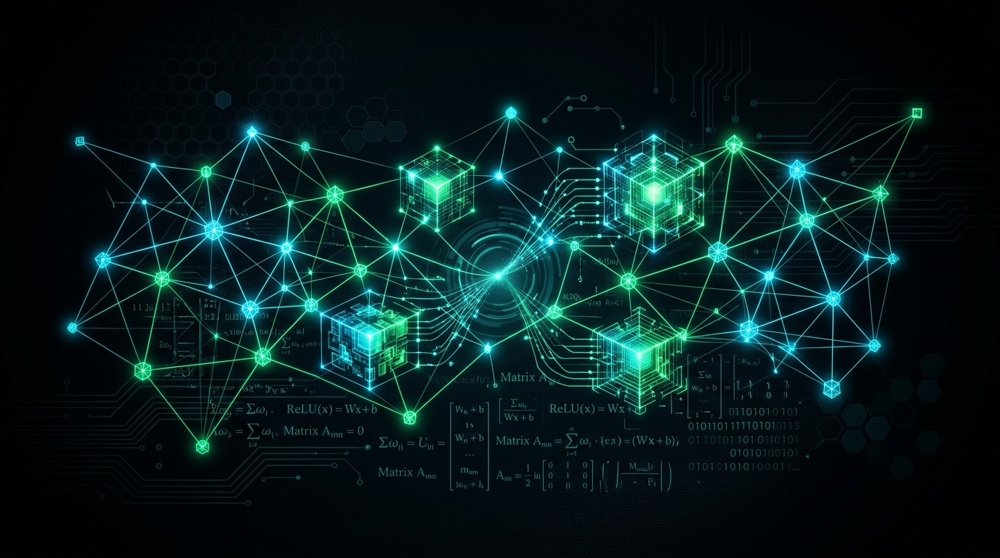

  
   

sthlm born and raised. kurdish background. mscs stud @ kth.

when i'm not studying, i'm usually working on low-level gpu acceleration, custom cuda kernels, simply because that's what the future will be about.
when i'm not doing the latter, i'm daydreaming.

currently exploring hopper (`sm_90`) primitives (which i really shouldn't be doing since i'm just a mscs stud) — focusing on asynchronous data movement with Tile IR, TMA bulk transfers, and hardware barriers to hide memory latency during attention and decode phases. check my project and contribute.

open for networking with people regardless of career track. 

irrelevant information: let's not call it 'artifical intelligence', but 'automation'.

### Projects
- **[CUDA](https://github.com/user01000000000010/CUDA)** — High-performance acceleration library implementing FlashAttention-3, DeepSeek-style MLA, FP8 PagedAttention, and fully fused in-SRAM blocks.

